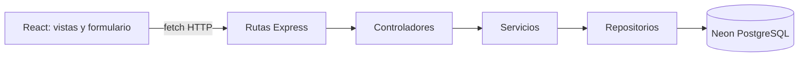

# Sistema de Información: Veterinaria Chiloé

Aplicación web para gestionar pacientes y fichas clínicas veterinarias. El frontend está construido con React y Vite; el backend expone una API REST con Express y persiste los datos en PostgreSQL.

Proyecto de la asignatura Tecnologías Web y Móviles de Ingeniería Civil en Informática, Universidad de Los Lagos.

## Stack Tecnológico

- Frontend: React, Vite y CSS.
- Backend: Node.js, Express y CORS.
- Persistencia: PostgreSQL en Neon.
- Despliegue: frontend en Vercel y API en Render.

## Arquitectura



Las rutas reciben `GET`, `POST` y `PUT` en `/api/pacientes`. Los controladores gestionan la petición y la respuesta HTTP; los servicios validan los datos; los repositorios delegan en PostgreSQL, incluidas las funciones almacenadas. El servicio frontend adapta `Perro`/`Gato` a `Canino`/`Felino` para la API.

## Requisitos

- Node.js y npm.

## Instalación y ejecución

Clona el repositorio e instala las dependencias del frontend desde la raíz:

```bash
git clone https://github.com/Vikktor93/vetChiloe.git
cd vetChiloe
npm install
```

Inicia el backend en una terminal:

```bash
cd server
npm install
npm run dev
```

Configura `server/.env` con `DATABASE_URL` de Neon antes de iniciar la API. Puedes usar `server/.env.example` como referencia. En otra terminal, desde la raíz, configura `.env` usando `.env.example` y luego inicia el frontend:

```bash
npm run dev
```

Abre la URL que muestra Vite, normalmente `http://localhost:5173/`. La API queda disponible en `http://localhost:3000/api/pacientes`.

La primera inicialización de la API crea la tabla `pacientes`. Después, ejecuta una vez el contenido de `sql/funciones.sql` en el SQL Editor de Neon antes de registrar pacientes o solicitar búsqueda y resumen. El script se puede volver a ejecutar.

## Despliegue

1. Crea una base de datos en Neon y copia su connection string como secreto `DATABASE_URL`. La API crea la tabla `pacientes` al arrancar.
2. Importa el repositorio en Render usando el `render.yaml` de la raíz. Configura `DATABASE_URL` con la cadena de Neon y `CORS_ORIGIN` con el dominio publicado en Vercel, por ejemplo `https://tu-app.vercel.app`.
3. Importa el mismo repositorio en Vercel. Configura `VITE_API_URL` con la URL de Render seguida de `/api`, por ejemplo `https://tu-api.onrender.com/api`, y despliega.
4. Comprueba `https://tu-api.onrender.com/health`; debe responder `{"status":"ok"}`.

No subas `.env` ni pegues la cadena de Neon en el repositorio. Usa las variables de entorno de Render y Vercel para los valores de producción.

## API

- `GET /api/pacientes`: obtiene el directorio de pacientes.
- `GET /api/pacientes/buscar?q=mer`: busca por nombre o especie sin distinguir mayúsculas.
- `GET /api/pacientes/resumen`: devuelve el total agrupado por especie.
- `POST /api/pacientes`: registra un paciente. PostgreSQL normaliza la especie y genera el número de atención.
- `PUT /api/pacientes/:id`: actualiza un paciente existente.
- `PUT /api/pacientes/:id/diagnostico` con `{"diagnostico":"Alta médica."}`: registra el diagnóstico anterior y actualiza el actual.

Pruebas rápidas con la API iniciada:

```bash
curl 'http://localhost:3000/api/pacientes/buscar?q=mer'
curl 'http://localhost:3000/api/pacientes/resumen'
```

La búsqueda de la interfaz filtra el directorio cargado al instante. El endpoint de búsqueda ejecuta `buscar_pacientes()` directamente en PostgreSQL para consultas sobre la base completa.

## Demostración

1. Ejecuta backend y frontend en terminales separadas.
2. Abre la sección **Fichas clínicas**: el directorio de tarjetas se carga mediante `GET /api/pacientes`.
3. Selecciona **Registrar paciente**, completa el formulario con especie Perro o Gato y envíalo.
4. La aplicación envía el alta a la API; el nuevo paciente aparece en el directorio con su número de atención.

Los datos se conservan en Neon entre reinicios del backend.